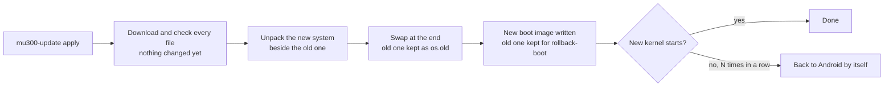

# Updating

**In one sentence:** `sudo mu300-update check` tells you whether there is a new release, `sudo mu300-update apply`
installs it on the device itself, and `rollback` takes you back if you do not like it.

**The simple version:** the device builds the new system next to the old one, and only swaps them at the very end.
If the download breaks halfway, nothing has changed. The old one stays in the cupboard until you throw it away.

## Commands

```sh
sudo mu300-update check           # installed version vs newest release
sudo mu300-update apply           # system, kernel and boot image: download, unpack, switch; then reboot
sudo mu300-update rollback        # back to the previous system
sudo mu300-update rollback-boot   # back to the previous kernel and boot image
sudo mu300-update kernel 7.2      # another kernel: 5.4 (vendor), 6.18 (LTS) or 7.2; no argument shows the current one
sudo mu300-update clean           # delete the kept previous version
```

On OpenWrt you are already root, so leave out `sudo`. `mu300-toolkit` offers the same under
**System -> Software update**. Reboot after `apply` to start the new system and kernel. Only one run at a time: a
second `mu300-update` started while one is going is refused with the first one's pid (from v2026.10.21 on).

The device looks for a new release at boot and every 6 hours and tells you at login, in `mu300-toolkit` and on the
control panel's home page. **It never installs one by itself.**

## From the browser (OpenWrt with the control panel)

**System > Update** in the [control panel](Control-Panel-(LuCI)) does all of the above without a terminal (from the
release after v2026.10.25 on). It runs the same `mu300-update`, so everything on this page applies to it too.

* **Installed** shows the system that runs and its release, the other systems on the device, the kernel, the boot
  image, whether a restart goes to Linux or Android, and the free space.
* **Online update:** *Check for updates* asks GitHub and shows the newest release, how much the device would
  download and how much free space the update wants. *Update* starts it. It runs on the device, not in your
  browser: you can close the page, and when you open it again, from any device, it shows how far the update is. At
  the end it offers *Restart now*. A pre-release (a release still being tried) is offered only when you tick it.
* **Update from a file**, for a device without internet: on another computer, download the Magisk zip of the
  release for your system and kernel from the release page (the page tells you its exact name, for example
  `mu300-magisk-v2026.11.02-openwrt-luci-k5.4.zip`) and upload it. Before anything is installed the page shows the
  file's SHA-256, the release, system and kernel it says it is, and whether the project's signature on it is valid.
  A file for another system, kernel or model is refused. A file without a valid signature is installed only after
  you tick that you know nothing proves where it comes from: compare its SHA-256 with `SHA256SUMS-magisk` on the
  release page first. One whose signature is wrong is never installed.
* **Previous version:** *Back to the previous version*, *Back to the previous boot image* and *Remove the previous
  version* are `rollback`, `rollback-boot` and `clean`. Each takes a tick and a confirmation.
* **Kernel:** switch between 5.4, 6.18 and 7.2 (`mu300-update kernel`), and *Start Android at the next restart*.

Only one update runs at a time. If one was started in a terminal, the page shows it and waits.

From a terminal the file works too: `mu300-update apply --from FILE.zip --unsigned` (`--unsigned` for a file that
is not signed), or `--from DIR` for a folder with a release's files and their `SHA256SUMS`. `mu300-update inspect
FILE.zip` only looks.

**An older release is never installed by itself**, from GitHub, a mirror or a file: `mu300-update apply` refuses a
release older than what is installed unless you add `--downgrade` (from the release after v2026.10.25 on; before,
`MU300_RELEASE=<older tag>` went back without asking). `rollback` needs no such word: it puts back the copy your
device kept.

### Signed releases

A release can carry a signature of its checksums (`SHA256SUMS.sig`). A system that has the project's release key
(`/opt/mu300/lib/release.pub`) checks it on every update and refuses a release whose signature is wrong, and one
that has none unless you say so (`--unsigned`). Systems up to v2026.10.25 have no key and update as they always did. Details:
[FINDINGS 86](https://github.com/dikeckaan/mu300-linux/blob/main/docs/FINDINGS.md).

## What an update keeps

* your settings (`/etc/mu300`: hotspot, VPN, toolkit), users and home directories, `/usr/local`, SSH host keys,
  OpenWrt's UCI configuration and services you enabled yourself;
* the jobs of OpenWrt's **System -> Scheduled Tasks** (`/etc/crontabs`; an update used to drop them, and with the
  directory empty `crond` did not start at all);
* the vendor files copied from your device (Wi-Fi firmware, the Android modem userspace);
* the installed extras: the lang extra is brought to the new release, the [VPN](VPN) module to its latest release;
* packages you installed yourself (`apk add`, `apt install`): see below.

## Packages you installed yourself

The release's image has only its own packages. `apply` lists the ones you added before it switches, and the new
system installs them again at its first boot, once it is online (an hour of tries, then again at the next boots, five
at most). Until they are back their OpenWrt settings (`/etc/config/<name>`) wait in `/etc/mu300/orphaned-config/`:
settings without their program used to stay active - OpenClash's left the device without DNS. A package the feeds do
not have (installed from a `.apk` file) cannot come back by itself; its settings stay aside. Services come back
enabled or disabled as they were (OpenWrt's init scripts, Ubuntu's systemd units).

On Ubuntu the apt sources you added (`/etc/apt/sources.list.d`, a PPA, with the keys they name, and your pinning in
`/etc/apt/preferences.d`) are kept, so their
packages can come back; the image's own sources are never replaced. A kept source that makes `apt-get update` fail
(a PPA of 24.04 after a move to 26.04) is turned off as `NAME.disabled`, and `status` says so.

In the control panel (OpenWrt with the panel) the same is under **System -> Packages after an update**: what came
back, what did not and why, the settings set aside, and the buttons Try again, Repair DNS (it asks first: DNS then
goes to the carrier) and Dismiss the note.

```sh
mu300-user-packages status    # what came back, what failed and why, how to put settings back
mu300-user-packages retry     # try again now
mu300-user-packages repair-dns  # a proxy that is gone left dnsmasq pointing at it: remove that (never done by itself)
mu300-update apply --no-reinstall   # update without installing them again (MU300_KEEP_PACKAGES=0 does the same)
```

## Why it is safe



* Every file is downloaded and checked before anything changes.
* From v2026.09.28 on, `apply` first switches to the updater of the release it installs.
* The boot image keeps your device's own part and gets the release's kernel and the generic part of its ramdisk, so
  no computer and nothing from Android is needed.
* A kernel that does not start sends the device back to Android after the usual number of failed boots. Even when
  Linux is [locked](Going-Back-to-Android#locked-linux), a new boot image gets its first boots on the usual attempts.

### With the VPN on

A device that uses the VPN is never updated without it. The update brings the module's core and every engine the
device has or a profile needs to their latest release, as one set (engines first, the core last). Offline, it stops
**before** it changes anything and says how to stage the module: put `mu300-linux-vpn-core.tar.gz` with the engine
tarballs (`mu300-linux-vpn-xray.tar.gz`, `-singbox`, `-mihomo`, `-dae`), or the bundle `mu300-linux-vpn.tar.gz` (core,
Xray and sing-box), and their `SHA256SUMS` in `/mnt/mu300-disk/.mu300-update/vpn/`, or run
`MU300_VPN_MODULE=DIR mu300-update apply`. A tarball without a matching `SHA256SUMS` is refused.

### On Ubuntu with the web panel

A new Ubuntu image has no Cockpit in it. The first boot after an update puts the panel extra's packages back in the
background (from the extra when it carries them, else from Ubuntu's archive once the device is online);
`mu300-panel status` says where it is.

## Changing the Ubuntu release

```sh
sudo MU300_UBUNTU=26.04 mu300-update apply   # or 24.04
```

Settings and data are kept. Ubuntu 26.04 needs kernel 6.18 or 7.2.

## Release names

A release is named after the day it was built, then a number: **`vYYYY.MM.DD.N`**. `v2026.10.16.1` is the first
release of 16 October 2026 (UTC), `v2026.10.16.2` the second one that day. The releases up to **v2026.10.27** had three
parts (`vYYYY.MM.DD`), and their "day" was only a counter that ran ahead of the calendar: v2026.10.27 came out on
15 October. So:

* every four-part name is newer than every three-part one, whatever the dates say: `v2026.10.16.1` is newer than
  `v2026.10.27`;
* four-part names go by the date, then by the number: `v2026.10.16.10` is newer than `v2026.10.16.9`, and
  `v2026.10.17.1` newer than both.

`mu300-update`, the control panel, the installers and the web installer all compare them this way. A device that
still runs **v2026.10.27 or older** updates to a four-part release as usual with `sudo mu300-update apply` (the new
release's own updater takes over before anything is changed), but its old updater sorts the names as text: until there
is a release dated 27 October 2026 or later, it does not show the "is out" note at login, and `mu300-update check`
there says the device is "newer than the newest release" - run `sudo mu300-update apply` anyway. Details:
[FINDINGS 125](https://github.com/dikeckaan/mu300-linux/blob/main/docs/FINDINGS.md).

## Updating with the computer installer instead

Run `./install.sh` again and answer **update** when it asks *update or wipe*. It reinstalls the systems, writes a fresh
boot image and keeps your settings and data. It also sets the password you type there.

## Coming from a very old release

**v2026.09.27 or older:** fetch the new updater first, then update, both right after a reboot (older boot images can
lose mobile data after a few quiet minutes):

```sh
sudo curl -fL https://github.com/dikeckaan/mu300-linux/releases/latest/download/mu300-update -o /opt/mu300/bin/mu300-update
sudo mu300-update apply
```

On OpenWrt, as root:

```sh
wget -O /opt/mu300/bin/mu300-update https://github.com/dikeckaan/mu300-linux/releases/latest/download/mu300-update
mu300-update apply
```

**Back in Android after an update?** With older boot images a single crash of Linux could leave the device in
Android. Start Linux with `su -c mu300-linux` (or the Magisk module's Action button), then update as above. If Linux
does not start any more, run the computer installer and choose `update`.

**From v2026.10.14 or older** an update prints "could not arm the Linux slot for a trial", because the older
`mu300-next-boot` does not know `--trial`. The fallback to Android after failed boots still works.

## Do not

* Do not use OpenWrt's `sysupgrade` or flash OpenWrt firmware images.
* Do not `apk upgrade` the `kernel` or `kmod-*` packages on OpenWrt.
